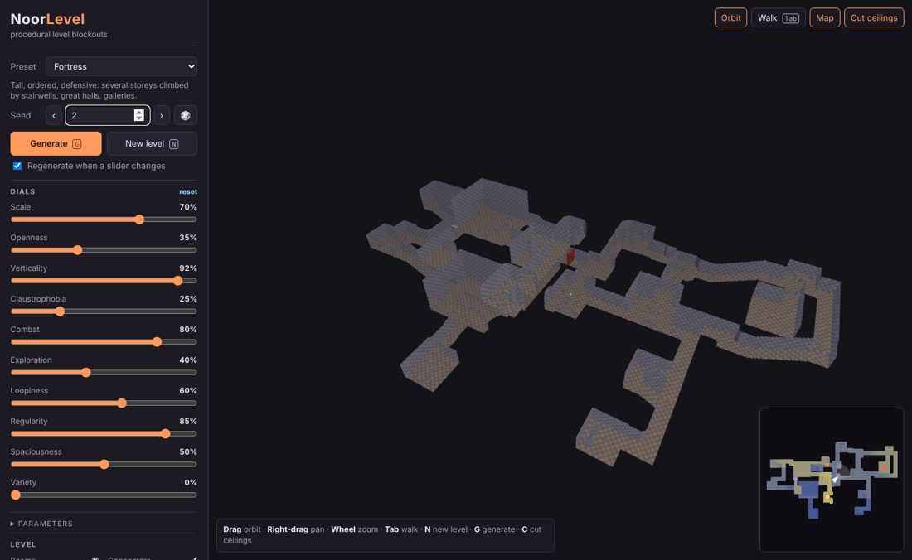

# NoorLevel

**BadLevel, reborn in C#.** A procedural FPS level generator as a plain .NET library (`NoorLevel.dll`,
no dependencies), a command line tool, and a previewer app where you generate a level, tweak it
with sliders, walk around it, generate another one, and export it.

Named for Noor, who brews the ideas. 🧡


| Orbit | Walk |
|---|---|
|  |  |

## What's inside

```
NoorLevel/
  NoorLevel.sln
  src/NoorLevel/            the DLL (netstandard2.1 + net8.0): generator, validator, exporters, preview API
  src/NoorLevel.Cli/        noorlevel-cli: generate / export from the command line, or serve the previewer
  src/NoorLevel.Previewer/  the Windows app: WinForms + WebView2 around wwwroot/ (three.js, bundled)
  tests/NoorLevel.Tests/    xunit
```

The generator is a port of BadLevel's core: a **mission graph** (critical path, locked doors and
their keys, side rooms, a secret, loops), **storeys** climbed by stairs, stairwells, spiral stairs,
lifts and ladders, **rooms** of many shapes (rectangles, L, T, U, plus, ring, octagon, hexagon,
diamond, round…), an **A\* corridor router** with widths and 45° runs, stairs on straight runs and
one-way drops, room features (pillars, platforms, pits, balconies, crates), lights, and a
**validator** that proves every level is finishable: directed reachability, keys before their doors,
no softlocks, every room reached, and a player-sized box fits everywhere it has to.

It does not reproduce Python's random numbers (it has its own xoshiro256\*\* stream), so seed 7 in
NoorLevel is a different level from seed 7 in BadLevel, but the same seed always gives the same
level in NoorLevel, on every platform.

## The previewer

On Windows (needs the [.NET 8 Desktop Runtime](https://dotnet.microsoft.com/download/dotnet/8.0)
and the WebView2 runtime, which Windows 10/11 already have):

```bash
dotnet run --project src/NoorLevel.Previewer
```

Anywhere else (or in a browser on Windows too), the same page served by the CLI:

```bash
dotnet run --project src/NoorLevel.Cli -- serve
```

then open http://localhost:5173.

* **Preset**, **seed** (‹ › and 🎲), **Generate** (G) and **New level** (N, a random seed).
* **Dials**: the ten design dials (scale, openness, verticality, claustrophobia, combat,
  exploration, loopiness, regularity, spaciousness, variety). With *Regenerate when a slider
  changes* on, letting go of a slider makes a new level.
* **Parameters**: the numbers the preset and dials give (main rooms, side rooms, loops, keys,
  storeys, 45° corridors, one-way drops, corridor height, secret room). Move one to pin it (●);
  click ● to give it back to the dials.
* **Orbit** (drag, right-drag, wheel; ceilings cut away so you see inside) and **Walk** (Tab):
  click the view, then WASD + mouse, Space jumps, Shift runs. Stairs step up, ledges drop, doors
  open as you come, **lifts** take you up when you stand on them (and come when you wait by
  them), **ladders** climb when you walk into them, E opens secret doors, R respawns. Reach the
  green exit and it says so. The minimap (M) shows where you are.
* **Export** to any of the formats below. In the app you get a Save dialog; in a browser, a download.

## Export formats

| Format | What you get | Use it in |
|---|---|---|
| `quake` | `.map` (Standard) + `noorlevel.wad` | TrenchBroom, ericw-tools → Quake |
| `quake2` | `maps/*.map` + `textures/noorlevel/*.wal` | TrenchBroom, ericw-tools (`-q2bsp`) → Quake 2 |
| `valve` | `.map` (Valve 220) + `noorlevel_hl.wad` (WAD3) | Half-Life (J.A.C.K., ZHLT, ericw `-hlbsp`), func_godot, other .map importers |
| `map` | the Quake `.map` alone | |
| `glb` | binary glTF, Y-up metres, a primitive per material, entities as named nodes with extras | Godot, Unity, Unreal, Blender |
| `obj` | `.obj` + `.mtl` | any 3D tool |
| `stl` | binary STL | 3D printing |
| `json` | the whole level: columns, rooms, corridors, entities, links, mission graph | your own tools |
| `svg` | a top-down plan, coloured by height | docs, sharing |

All three .map flavours compile with ericw-tools without leaks (checked on every preset).

## Command line

```bash
noorlevel-cli generate --preset fortress --seed 12 --dial verticality=1 --set storeys=3 --format glb,quake --out levels
noorlevel-cli presets
noorlevel-cli formats
noorlevel-cli sweep 5          # every preset x 5 seeds, every format
noorlevel-cli serve --port 5173
```

## Using the DLL

```csharp
using NoorLevel;
using NoorLevel.Export;

var level = Generator.Generate("classic", seed: 42, tweak: r => { r.Verticality = 0.9; r.Combat = 0.2; });
File.WriteAllBytes("level.glb", Gltf.ToGlb(level));
File.WriteAllText("level.map", MapExport.ToMap(level, MapGame.Quake));

// or full control:
var cfg = Recipes.Compile(Recipes.Presets["bunker"], seed: 3);
cfg.Keys = 2;
cfg.Storeys = 4;
var level2 = Generator.Generate(cfg);
Console.WriteLine(level2.Report.Ok);    // always true: Generate retries until the validator passes
```

`Level` holds everything: `Spans` (per grid column, the open intervals: a stacked-span model, so
rooms can sit over rooms), `Rooms`, `Corridors`, `Entities` (player start, exit, keys, doors,
secret doors, lifts, ladders, lights), `Links` (lifts and ladders as traversals), the mission
`Graph` and the validation `Report`.

## Building and testing

To compile everything (the EXEs and DLLs) into `dist/`, install the [.NET 8 SDK](https://dotnet.microsoft.com/download/dotnet/8.0) and run:

```bash
build.cmd
```

`build.cmd full` makes self-contained single-file EXEs that run without .NET installed. On
Linux/macOS, `./build.sh` (or `./build.sh full`) builds the same Windows binaries. Either way you get:

| File | What it is |
|---|---|
| `dist/Previewer/NoorLevelPreviewer.exe` (+ `wwwroot/`) | the previewer app |
| `dist/Cli/noorlevel-cli.exe` | the command line tool |
| `dist/Library/NoorLevel.dll` | the library, to reference from your own projects (Unity can use it too: netstandard2.1) |

Or by hand:

```bash
dotnet build NoorLevel.sln
dotnet test tests/NoorLevel.Tests
```

The Windows previewer builds on Linux/macOS too (`EnableWindowsTargeting`), it just only runs on Windows.

## Not yet ported from BadLevel

The core is here; the feature modules come next: hall cross-sections and styles, windows and
vistas, water and floods, dungeons, the wizard's tower, the goblin market, arena / CTF modes,
facility, mega-rooms, courtyards, sloped vaults. Monsters, weapons and items are left out on
purpose: NoorLevel makes the space, the game fills it.

three.js (MIT) is bundled in `wwwroot/vendor` so the previewer works offline.
