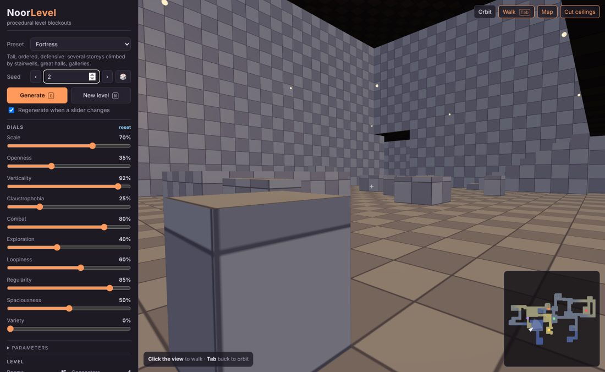
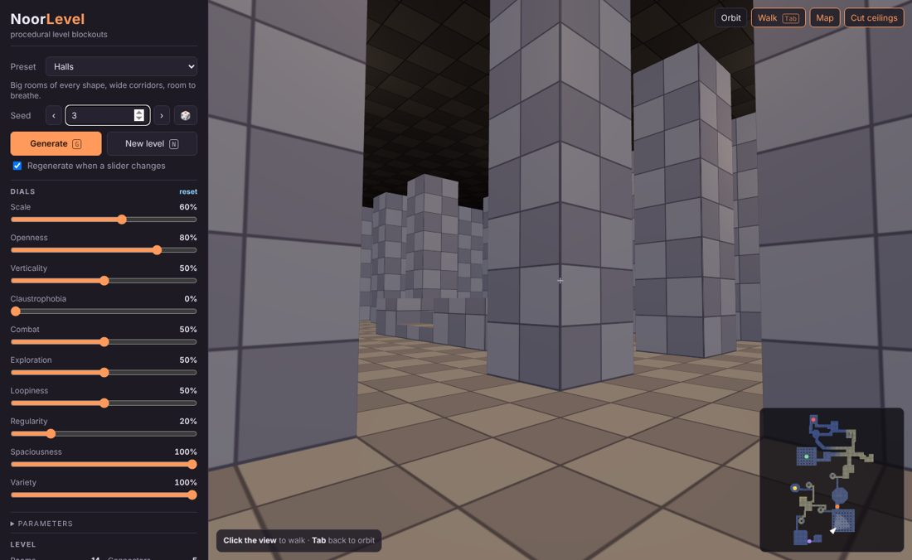

# NoorLevel

**BadLevel, reborn in C#.** A procedural FPS level generator as a plain .NET library (`NoorLevel.dll`,
no dependencies), a command line tool, and a previewer app where you generate a level, tweak it
with sliders, walk around it, generate another one, and export it.

Named for Noor, who brews the ideas. 🧡



| Orbit | Walk |
|---|---|
|  |  |

## What's inside

```
NoorLevel/
  NoorLevel.sln
  src/NoorLevel/            the DLL (netstandard2.1 + net8.0): generator, validator, exporters, preview API
  src/NoorLevel.Cli/        noorlevel-cli: generate / export from the command line, or serve the previewer
  src/NoorLevel.Previewer/  the Windows app: WinForms + WebView2 around wwwroot/ (three.js, bundled)
  tests/NoorLevel.Tests/    xunit
```

The generator is a full port of BadLevel: a **mission graph** (critical path, locked doors and
their keys, side rooms, a secret, loops; hub / central / linear compositions), **storeys** climbed by
stairs, stairwells, spiral stairs, lifts and ladders (or in from the surface and down, underground),
**rooms** of many shapes, **merged halls**, **corridor beats** (chambers, rotundas, aisles), **courtyards**
open to the sky with roofscapes and free-standing buildings, **mega-rooms** (hangars, works halls,
terraces), **divided floor plans**, an **A\* corridor router** with widths, 45° runs, vents, one-way drops,
stairs and smooth **ramps**; **architecture** in styles (gothic, industrial, bunker, compound, castle,
egyptian, sci-fi): hall cross-sections with piers and sloped vaults and roofs, structure along the walls,
framed portals, a landmark; **windows** (slits and glass), galleries, overlooks and **vistas** onto a
landscape; room features (pillars, platforms, pits, balconies, crates, hazard pools, spiked chasms with
bridges, jump-pad towers); **dungeons** (torches, grates open to the sky, traps, flooded crypts and
sumps); the **wizard's tower** (a helix hall), the **goblin market** (streets of stalls), **room programs**
(facility sectors, dungeon wings, the wizard's libraries); **arena**, **duel** and **CTF** maps (spawns,
mirrored team halves, flags); and a **validator** that proves every level is finishable: directed
reachability, keys before their doors, no softlocks, enough air under water, every room reached, and a
player-sized box fits everywhere it has to.

All 19 BadLevel presets are here (compact, classic, bunker, fortress, industrial, compound, techbase,
runekeep, outpost, grand, facility, complex, dungeon, wizard, market, arena, ctf, duel, explore), NoorLevel's own
**station** (deep-sea stations, below), and **surprise** (a preset drawn by the seed with extras rolled on top). Monsters, weapons and items are
left out on purpose: NoorLevel makes the space, the game fills it (arena maps record where the weapons
and power-ups would go in `Level.Arena`).

It does not reproduce Python's random numbers (it has its own xoshiro256\*\* stream), so seed 7 in
NoorLevel is a different level from seed 7 in BadLevel, but the same seed always gives the same
level in NoorLevel, on every platform.

## The previewer

On Windows (needs the [.NET 8 Desktop Runtime](https://dotnet.microsoft.com/download/dotnet/8.0)
and the WebView2 runtime, which Windows 10/11 already have):

```bash
dotnet run --project src/NoorLevel.Previewer
```

Anywhere else (or in a browser on Windows too), the same page served by the CLI:

```bash
dotnet run --project src/NoorLevel.Cli -- serve
```

then open http://localhost:5173.

* **Preset** (all 19, plus Surprise), **seed** (‹ › and 🎲), **Generate** (G) and **New level** (N, a random seed).
* **Dials**: the ten design dials (scale, openness, verticality, claustrophobia, combat,
  exploration, loopiness, regularity, spaciousness, variety). With *Regenerate when a slider
  changes* on, letting go of a slider makes a new level.
* **Parameters**: the ones you reach for most: map size (the level's longer side in metres), storeys
  (up to 6), rooms over rooms (stacking), main and side rooms, loops, keys, 45° corridors, one-way drops,
  corridor height. Move one to pin it (●); click ● to give it back to the dials.
* **All parameters**: every one of the ~85 settings, grouped, with a search box and a description on each.
* **Features**: switch off pillars, wall structure, portal frames, the landmark, crates, windows, the secret room.
* **Orbit** (drag, right-drag, wheel; ceilings cut away so you see inside) and **Walk** (Tab):
  click the view, then WASD + mouse, Space jumps, Shift runs. Stairs step up, ledges drop, doors
  open as you come, ramps are smooth, you **swim** in water (Space swims up), **jump pads** throw you
  onto the high ground, glass is solid, **lifts** take you up when you stand on them (and come when you wait by
  them), **ladders** climb when you walk into them, E opens secret doors, R respawns. Reach the
  green exit and it says so. The minimap (M) shows where you are.
* **Export** to any of the formats below. In the app you get a Save dialog; in a browser, a download.

## Export formats

| Format | What you get | Use it in |
|---|---|---|
| `quake` | `.map` (Standard) + `noorlevel.wad` | TrenchBroom, ericw-tools → Quake |
| `quake2` | `maps/*.map` + `textures/noorlevel/*.wal` | TrenchBroom, ericw-tools (`-q2bsp`) → Quake 2 |
| `valve` | `.map` (Valve 220) + `noorlevel_hl.wad` (WAD3) | Half-Life (J.A.C.K., ZHLT, ericw `-hlbsp`), func_godot, other .map importers |
| `map` | the Quake `.map` alone | |
| `glb` | binary glTF, Y-up metres, a primitive per material, entities as named nodes with extras | Godot, Unity, Unreal, Blender |
| `obj` | `.obj` + `.mtl` | any 3D tool |
| `stl` | binary STL | 3D printing |
| `json` | the whole level: columns, rooms, corridors, entities, links, mission graph | your own tools |
| `noorengine` | a NoorEngine project: the level as a Noor Interchange asset (GLB + `.noor.json` + recipe), a scene with every part as a mesh with a static collider, point lights, a first-person player, and **Coth** wandering the rooms | NoorEditor: open the folder, press Play |
| `svg` | a top-down plan, coloured by height | docs, sharing |

All three .map flavours compile with ericw-tools without leaks (checked on every preset).

## Deep-sea stations (`--preset station`)

A station is a built object under pressure: round and octagonal **pods** (8–14 m) on a **spine** of
pressure **tubes** (one long line, a ring round a hub, or a branching tree), the docking **airlock on the
top deck**, the **core at the bottom**, decks joined by stair tubes only (no lifts, ladders or spirals).
Tubes are round in cross-section (`corridor_profile=round`; `chamfer` and `round` work on any preset too).
One to three **character rooms** per station (a moon pool, a domed lab, a flooded wing, a collapsed tube,
a hydroponics bay) and a **style** (`station_style`: research, mining, military, derelict).

Every room has a job (`program_set=station`: dive locker, quarters, galley, medbay, hydroponics, lab,
sonar room, moon pool, generator, reactor...) and is **dressed with markers** for the game to fill:
props (consoles, bunks, lockers, pipe runs, debris...) and gameplay spots (loot, log terminals, creature
spawns, hiding spots, power junctions, hazard zones, the airlock, viewports, pressure doors).
Eight examples with plans: [`examples/station/`](examples/station/index.html). The design brief:
[`docs/STATIONS_BRIEF.md`](docs/STATIONS_BRIEF.md); the decisions: [`docs/DECISIONS.md`](docs/DECISIONS.md).

```bash
noorlevel-cli generate --preset station --seed 7 --set spine=ring --set station_style=derelict --set map_size=64 --format glb --out station_7.glb --json-result
```

The markers work on any preset too (all off by default): `dressing`, `dressing_density`,
`station_entities`, `viewports`, `part_meta`, `program_set=station`.

## Consumer contract: markers in the .glb

What a game reads from a NoorLevel .glb (Solitude's importer is written against this; the station
markers' place in Noor Interchange is proposed in [`docs/INTERCHANGE_PROPOSAL.md`](docs/INTERCHANGE_PROPOSAL.md)).

- **Axes and units.** glTF: right-handed, **+Y up, metres**. A map point (x, y, z) (Z up, 32 units = 1 m)
  is glTF (x/32, z/32, −y/32).
- **The level.** The root node `level_geometry`; its children are the **parts**, one mesh each, named
  `room:5`, `room:5/vault`, `corridor:3`, `room:7/consoles`... Materials `nl_floor`, `nl_wall`, `nl_ceiling`,
  `nl_sky`, `nl_water`... Part extras: `{part}`; with `part_meta`: also `room`, `kind`, `program`, `sector`,
  `style`, `profile`. A station's root node has `extras.noor.station = { style, spine, seed }`.
- **Markers** are empty nodes named `<kind>_<n>` (numbered per kind, in order; the station kinds come after
  every older kind, so older names never change). Each has:
  - `translation`: its **origin**. `floor` mount: the centre of the footprint on the floor. `wall`: on the
    wall surface, at the bottom centre of the back face (the piece reaches `d` into the room, `h` up).
    `ceiling`: on the ceiling, top centre (it hangs `h` down).
  - `rotation`: yaw only, a quaternion; the marker's **forward is its local +Z** (what a console faces, where
    a locker opens, into the pod for a door). Always a multiple of 90°.
  - `extras`: the flat form (`kind` and every field) and `extras.noor = { v: 1, marker, id (= the node
    name), ...fields }`. Only fields that apply are present.

| Node kind | `noor.marker` | Fields |
|---|---|---|
| `prop` | `prop` | `class` (console, desk, chair, locker, bunk, bed, crate, shelf, pump, valve_wheel, pipe_run, cable_run, vent_grate, debris, bones, stain, sign...), `mount` (floor / wall / ceiling), `footprint` [w, d, h] m (across, along forward, up), `variant` 0–7, `tags` (broken, blockout, flat, vent), `room` / `corridor`, `program`, `sector`, `props.text` (signs), `props.block` (the furniture part it stands for) |
| `loot` | `pickup` | `class` "loot", `size` small / medium / large, `on` (the prop it sits on) |
| `log_terminal` | `interact` | `class` "log_terminal", `on` |
| `creature_spawn` | `spawn.enemy` | `class` "creature", `role` nest / ambush / patrol |
| `hiding_spot` | `hide` | `class` (locker, desk), `on` |
| `power_junction` | `interact` | `class` "power_junction", `mount` wall, `footprint` |
| `hazard_zone` | `trigger` | `event` "hazard", `type` flooded / electrified, `size` [x, y up, z] m; the node is the box's bottom centre |
| `airlock` | `entrance` | `kind` "airlock", `mount` wall, `footprint` [1, 0.2, 2.2] |
| `viewport` | `viewport` | `mount` wall, `footprint` [0.6, 0.1, 0.6] (nothing is cut: the game opens it) |
| `bulkhead` | `door` | `opens` "slide", `width`, `height` m, `room`, `corridor`; faces into the pod |

The older kinds (`player_start`, `exit`, `key`, `door`, `secret_door`, `light`, `torch`, `lift`, `ladder`,
`window`, `spawn`, `flag`, `jumppad`, `trap`...) are nodes named the same way with their fields in flat
`extras`. The IR JSON (`--format json`) carries every marker too, in map units (Z up): `pos` is the origin,
`lo` / `hi` its box.

## Runtime generation (a game calling the CLI)

`noorlevel-cli` as one self-contained file (no .NET needed), precompiled so a single run is quick:
`dotnet publish src/NoorLevel.Cli -p:PublishProfile=win-x64` (or `linux-x64`) writes `dist/cli-<rid>/`
(about 16 / 20 MB). One run (start, generate a station, write the .glb) takes **0.4–0.65 s** on a
desktop CPU (station, map_size 48–72; medians of 5 seeds: 48 m 638 ms, 56 m 419 ms, 64 m 421 ms,
72 m 468 ms). Output is byte-identical to every other build.

```bash
noorlevel-cli generate --preset station --seed 1234 --out user/stations/st_1234.glb --json-result --max-ms 5000
# {"ok":true,"file":"user/stations/st_1234.glb","ms":412,"seed":1234,"recipe":"station","rooms":8,"errors":[]}
```

- `--out` a file name ending in the format's extension writes exactly that file (a folder works as before).
- `--json-result`: one JSON line; exit codes 0 ok, 1 no valid level (try another seed), 2 bad parameter,
  3 `--max-ms` passed, 4 couldn't write.
- `--max-ms`: a hard upper bound; past it the run gives up cleanly.

## Into the Noor Engine (Coth gets lost)

`--format noorengine` (or the **NoorEngine project** export button) writes a folder you open in
NoorEditor and play:

```bash
noorlevel-cli generate --preset dungeon --seed 1 --format noorengine --coth path/to/NoorEngine/samples/Hillside/Assets/Sprites
```

- The level arrives the way BadBuilding's buildings do: a Noor Interchange asset of kind `level`
  (manifest checked against NoorEngine's `noor.asset.schema.json`), every room, corridor and element
  its own mesh (`room:5/vault`), placed as its own entity with a static mesh collider.
- The lamps and torches become point lights (the engine draws the 16 nearest).
- The player: a character controller (1.7 m, steps 0.6 m) with a first-person script made from the
  engine's FPS sample, and a HUD that says how far Coth is.
- **Coth** (The Uncounted): his 8-direction sprite on a character controller, and a script with a
  route NoorLevel works out from the level itself (only places he can walk to). He starts halfway in,
  wanders from room to room, looks around in each, and stops to look at you when you find him.
  (`--coth` copies his sprite files in; without it, copy them from NoorEngine's
  `samples/Hillside/Assets/Sprites` into `Assets/Sprites`.) The previewer finds them by itself when a
  `Coth` folder sits next to the app.
- Scale: one cell is one metre. Doors, lifts and keys are left open in this first export.

## Command line

```bash
noorlevel-cli generate --preset fortress --seed 12 --dial verticality=1 --set storeys=3 --format glb,quake --out levels
noorlevel-cli presets
noorlevel-cli formats
noorlevel-cli sweep 5          # every preset x 5 seeds, every format
noorlevel-cli serve --port 5173
```

## Using the DLL

**The full guide: [docs/USING_THE_DLL.md](docs/USING_THE_DLL.md)** (adding it to a project, Unity and Godot,
every parameter, reading a level, exporting, a mesh for your own engine), and the parameter reference
**[docs/PARAMETERS.md](docs/PARAMETERS.md)**. A short taste:

```csharp
using NoorLevel;
using NoorLevel.Export;

var level = Generator.Generate("classic", seed: 42, tweak: r => { r.Verticality = 0.9; r.Combat = 0.2; });
File.WriteAllBytes("level.glb", Gltf.ToGlb(level));
File.WriteAllText("level.map", MapExport.ToMap(level, MapGame.Quake));

// or full control:
var cfg = Recipes.Compile(Recipes.Presets["bunker"], seed: 3);
cfg.Keys = 2;
cfg.Storeys = 4;
var level2 = Generator.Generate(cfg);
Console.WriteLine(level2.Report.Ok);    // always true: Generate retries until the validator passes
```

`Level` holds everything: `Spans` (per grid column, the open intervals: a stacked-span model, so
rooms can sit over rooms), `Rooms`, `Corridors`, `Entities` (player start, exit, keys, doors,
secret doors, lifts, ladders, lights), `Links` (lifts and ladders as traversals), the mission
`Graph` and the validation `Report`.

## Building and testing

To compile everything (the EXEs and DLLs) into `dist/`, install the [.NET 8 SDK](https://dotnet.microsoft.com/download/dotnet/8.0) and run:

```bash
build.cmd
```

`build.cmd full` makes self-contained single-file EXEs that run without .NET installed. On
Linux/macOS, `./build.sh` (or `./build.sh full`) builds the same Windows binaries. Either way you get:

| File | What it is |
|---|---|
| `dist/Previewer/NoorLevelPreviewer.exe` (+ `wwwroot/`) | the previewer app |
| `dist/Cli/noorlevel-cli.exe` | the command line tool |
| `dist/Library/NoorLevel.dll` | the library, to reference from your own projects (Unity can use it too: netstandard2.1) |

Or by hand:

```bash
dotnet build NoorLevel.sln
dotnet test tests/NoorLevel.Tests
```

The Windows previewer builds on Linux/macOS too (`EnableWindowsTargeting`), it just only runs on Windows.

## How the port was done

`PORTING.md` is the rulebook: every Python module has a C# file of the same name and every function a
predictable C# name, so the modules could be ported in parallel and still call each other.

three.js (MIT) is bundled in `wwwroot/vendor` so the previewer works offline.
